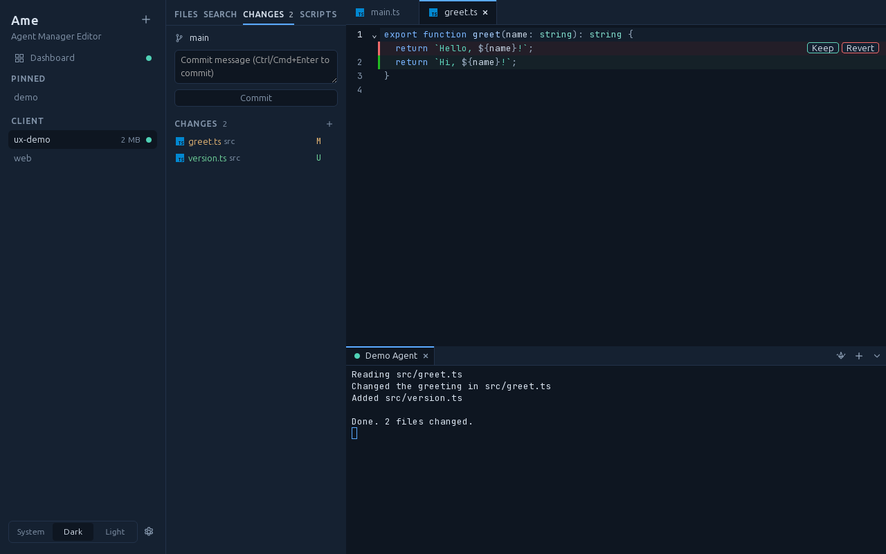
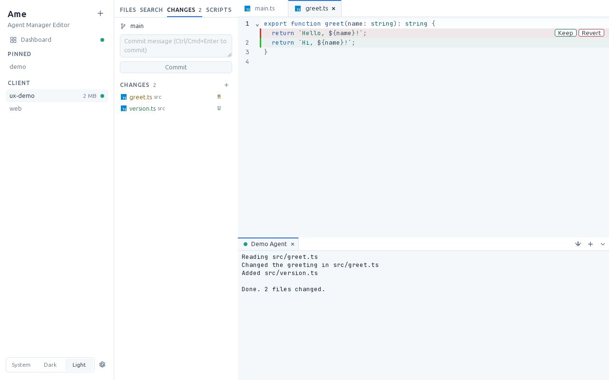
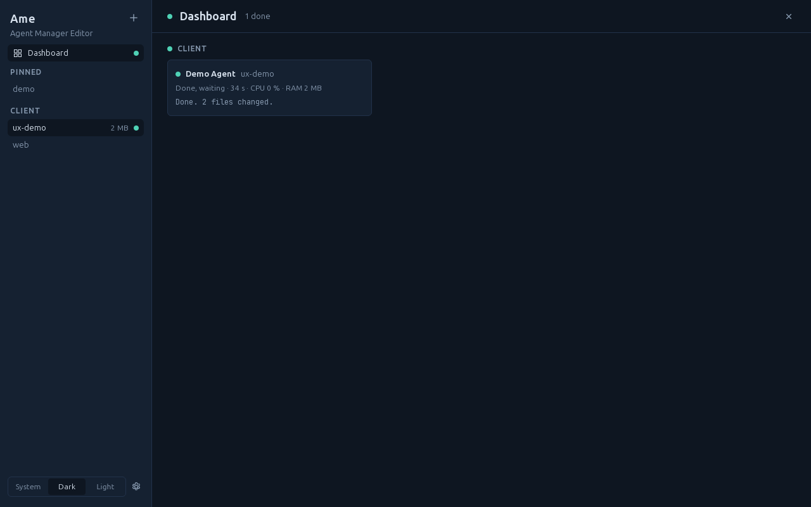

# Ame — Agent Manager Editor

> **Ame** (雨) is Japanese for _rain_. Every drop is a signal.

## The problem

Coding agents like Claude Code, Codex CLI or Gemini CLI work on their own
for minutes at a time. So you start several of them, in several projects —
and then the juggling begins:

- A dozen terminal windows, and no idea which agent is still working, which
  one finished ten minutes ago and which one has been **waiting for your
  permission** all along.
- You switch between projects all day, but every switch means finding the
  right window, editor and terminal again.
- To see **what an agent changed**, you open a full IDE next to it — which
  indexes everything and eats gigabytes of memory just to show a diff.
- When an agent is done, its next task waits until you notice.

**Ame turns this into one calm window:** all your projects in a sidebar,
every agent's state visible at a glance (and a notification when one needs
you), and the files and diffs of what it changed right next to its
terminal — without the weight of an IDE.

## What it is

Ame is a lean, cross-platform desktop app for **agentic coding**. It keeps
many projects open at once and runs any terminal coding agent per project —
Claude Code, Codex CLI, Gemini CLI, Aider, OpenCode or a plain shell — and
shows at a glance which agent is working, waiting for you, done or crashed.

Ame is **not** an IDE replacement. There is no indexing and no language
server by default. It is a cockpit: terminals, agent status, a file tree,
a lightweight editor and a live diff of what your agents changed.

> **Status:** pre-alpha, heading for 0.1. Projects, editor, terminals,
> agents with live status, git, scripts and project groups work; the first
> release is being prepared. See the [roadmap](docs/ROADMAP.md).



## What Ame does

- **Low memory, fast start.** A Rust backend, no indexing, lazy loading
  everywhere. Startup under one second; memory is measured in CI on every
  change (see [ADR 0022](docs/decisions/0022-self-measuring-benchmarks.md)).
- **Switch projects instantly.** All open projects live in one sidebar,
  one click or `Ctrl/Cmd+1…9` away.
- **Know what your agents are doing.** A dashboard and status dots show
  whether each agent is _working_, _needs input_, _idle_, _exited_ or in
  _error_, plus a system notification when it needs you. Claude Code
  reports its state precisely through its hooks.
- **Keep agents busy.** Queue follow-up prompts that are sent when the
  agent is done, and every prompt takes a git checkpoint you can roll back
  to.
- **Work across projects.** Group projects, start an agent with access to
  the whole group, or send one prompt to the agents of every project in
  it.
- **See the code.** File tree, editor and a live diff of agent changes next
  to the terminal.
- **Run scripts.** `package.json` and `composer.json` scripts as one-click
  tasks.

## Screenshots

| Light theme                                                            | Dashboard                                                              |
| ---------------------------------------------------------------------- | ---------------------------------------------------------------------- |
|  |  |

## Installation

There are no releases yet. Release 0.1 will ship (see
[docs/RELEASING.md](docs/RELEASING.md)):

| Platform | Format                                |
| -------- | ------------------------------------- |
| macOS    | `.dmg` (universal)                    |
| Linux    | AppImage, `.deb`                      |
| Windows  | Installer and a portable `.exe` (ZIP) |

Early builds will not be code-signed. macOS Gatekeeper and Windows
SmartScreen will warn you before the first launch. The Windows build needs
the WebView2 runtime, which is preinstalled on Windows 10 and 11.

### Portable mode (Windows)

The portable ZIP already contains it: an empty file named `portable` (or
`portable.txt`) next to `Ame.exe`.
Ame then stores its settings and web view data in a `data` folder next to
the executable instead of your user profile, so you can run it from a USB
stick without installing anything.

## Building from source

### Prerequisites

- [Rust](https://rustup.rs/) (stable)
- [Node.js](https://nodejs.org/) 24 or newer and [pnpm](https://pnpm.io/)
- The Tauri 2 system dependencies for your platform, see
  [Tauri prerequisites](https://v2.tauri.app/start/prerequisites/).
  On Debian/Ubuntu:

  ```sh
  sudo apt-get install build-essential pkg-config curl wget file \
    libwebkit2gtk-4.1-dev libxdo-dev libssl-dev \
    libayatana-appindicator3-dev librsvg2-dev
  ```

### Run

```sh
pnpm install
pnpm tauri dev     # start the app in development mode
pnpm tauri build   # build a release bundle for your platform
```

See [CONTRIBUTING.md](CONTRIBUTING.md) for all checks, conventions and the
project layout.

## Documentation

- [Roadmap](docs/ROADMAP.md)
- [Vision and principles](docs/VISION.md)
- [Architecture](docs/ARCHITECTURE.md)
- [Design and UX](docs/DESIGN.md)
- [Architecture decision records](docs/decisions/)
- [Changelog](CHANGELOG.md)

## Contributing

Contributions are welcome — bug reports, agent profiles for new CLIs,
translations and code. Please read [CONTRIBUTING.md](CONTRIBUTING.md) and
our [Code of Conduct](CODE_OF_CONDUCT.md). Security issues: see
[SECURITY.md](SECURITY.md).

## License

Licensed under either of

- Apache License, Version 2.0 ([LICENSE-APACHE](LICENSE-APACHE) or
  <https://www.apache.org/licenses/LICENSE-2.0>)
- MIT license ([LICENSE-MIT](LICENSE-MIT) or
  <https://opensource.org/licenses/MIT>)

at your option.

Unless you explicitly state otherwise, any contribution intentionally
submitted for inclusion in the work by you, as defined in the Apache-2.0
license, shall be dual licensed as above, without any additional terms or
conditions.
